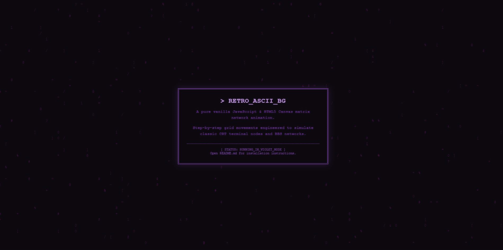

<!-- =========================================================================
     PROJECT:     RETRO_ASCII_BG
     AUTHOR:      BjornEriksson / Björn Eriksson
     LICENSE:     MIT License
     DESCRIPTION: Documentation and deployment guide for the vanilla JS 
                  retro terminal matrix-like background animation shell.
     ========================================================================= -->
# RETRO_ASCII_BG



A lightweight, high-performance background animation written in pure vanilla JavaScript using HTML5 Canvas. It simulates a retro computing environment with glowing digital ASCII characters moving programmatically inside a synchronized grid layout, offering a subtle cyberpunk or matrix-rain inspired aesthetic.

Instead of flowing fluidly down the viewport like traditional matrix scripts, characters move step-by-step in a fixed node matrix, beautifully mimicking old CRT monitors, BBS networks, and early command-line interfaces.

## Features
* **Plug & Play:** Automatically injects the canvas element and background positioning styles if they are missing from your project.
* **Zero Dependencies:** Pure vanilla JavaScript and HTML5 Canvas with no external libraries required.
* **Fully Responsive:** Listens to window lifecycle changes and automatically resizes dynamically.
* **Low Resource Usage:** Employs a controlled interval loop to mimic retro hardware clock cycles, saving critical CPU overhead.

## Installation

1. Download `background.js` and move it into your local project directory.
2. Include the script anywhere inside your HTML file (ideally right before the closing `</body>` tag):
```html
<script src="background.js"></script>
```

3. That's it! The script automatically boots up, creates the `#ascii-bg` canvas element, and injects it behind your content layout. 

*Note: To ensure your text and layout sit properly on top of the animation matrix, make sure your primary foreground container has a higher z-index (e.g., `position: relative; z-index: 1;`) in your CSS.*

## Customization

Inside `background.js`, you can easily tweak the core variables to fit your project's specific vibe:

* **Glyph Pool:** Modify the `bgChars` array to change which characters appear on screen.
* **Grid Density:** Adjust `cellSize = 22` to make the characters smaller (lower values) or larger (higher values).
* **Phosphor Color:** Change `ctx.fillStyle = '#4a154b'` to change the matrix tint. Try changing it to Amber `#ffb000`, classic Phosphor Green `#1b4d1b`, or Cyber-Blue `#00ddff`.
* **Clock Cycles:** Modify the interval speed `220` (in milliseconds) to accelerate or decelerate the network matrix updates.

## License
MIT License. Feel free to use, modify, and distribute this layout engine in your own personal or commercial retro applications!
